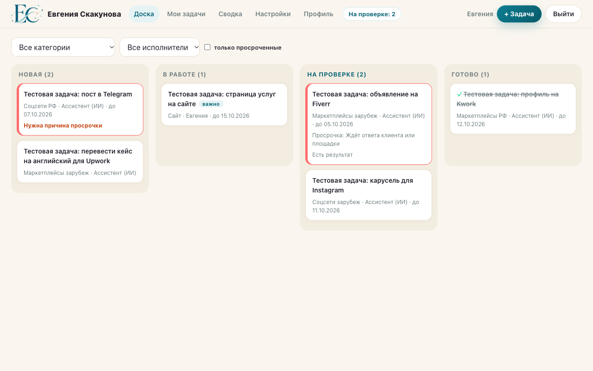
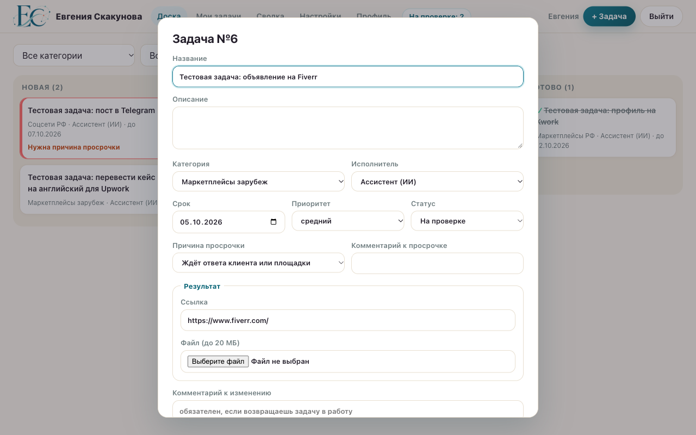
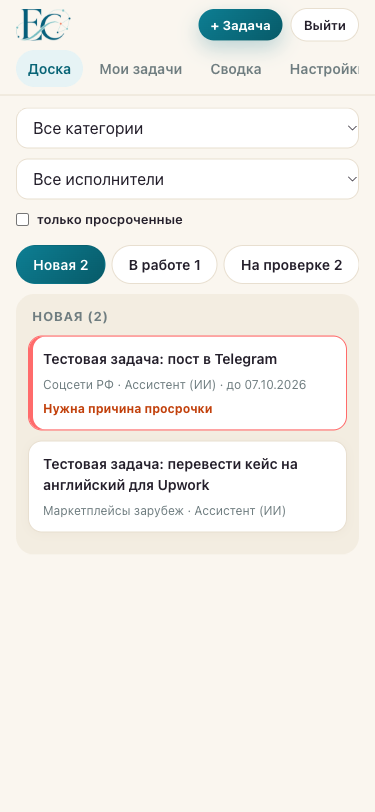

# Растем с ИИ · Задачи

Трекер задач для проекта «Растем с ИИ»: владелец ставит и проверяет задачи, ИИ-ассистент выполняет их и сдаёт на проверку через API.

**Живой проект:** https://tracker.evskakunova-ai.ru (вход по логину, демо-доступ по запросу)

## Какую задачу решает

Задачи проекта были разбросаны по чатам с ИИ, Telegram и заметкам: закрытые числились открытыми, а что сдал ассистент и что ждёт проверки, было не видно. Трекер даёт одно место, где видны все задачи по направлениям, исполнитель, срок, результат и причина просрочки.

## Для кого

- **Владелец** ставит задачи, принимает результат, управляет пользователями, категориями и ключом API.
- **ИИ-ассистент** (Claude Code, Codex или любой агент) берёт задачи через API, меняет статус, пишет комментарии, прикладывает результат файлом или ссылкой и предлагает новые задачи (не больше 5 непринятых).

## Стек

Node.js 22 (встроенный `node:sqlite`), Express, чистый HTML/CSS/JS без фреймворков, Docker Compose, ночные резервные копии. Собран на вайбкодинге в Claude Code за три итерации.

## Скриншоты

| Доска | Карточка задачи | Телефон |
|---|---|---|
|  |  |  |

ТЗ: `info/TZ.md`, протокол тестирования: `info/testing.md`.

## Запуск на компьютере

Нужен Node.js 22.5 или новее (используется встроенный `node:sqlite`).

```bash
npm install
cp .env.example .env.local   # впишите пароли владельца и ассистента
npm run dev                  # http://localhost:3000
npm test                     # автотесты на временной базе
```

Пароли из `.env.local` используются только при первом запуске, когда база пустая. Потом пароли меняются в профиле.

## Запуск в Docker

```bash
docker compose up -d --build
```

База и файлы лежат в томе `tracker-data` (`/data` внутри контейнера).

## API ассистента

Владелец выпускает ключ в «Настройках». Все запросы с заголовком `Authorization: Bearer <ключ>`.

| Запрос | Что делает |
|---|---|
| `GET /api/tasks?mine=1&status=new` | мои задачи |
| `GET /api/tasks/:id` | задача с историей |
| `PATCH /api/tasks/:id` | статус (Новая → В работе → На проверке), `overdue_reason`, `overdue_comment`, `comment` |
| `POST /api/tasks/:id/comments` | комментарий `{ "text": "..." }` |
| `POST /api/tasks/:id/result` | результат: JSON `{ "result_url": "https://..." }` или multipart с полем `file` (до 20 МБ) |
| `POST /api/proposals` | предложить задачу (не больше 5 непринятых) |

Причины просрочки: `waiting_owner`, `waiting_external`, `no_access`, `underestimated`, `priority_changed`, `other` (нужен комментарий).
